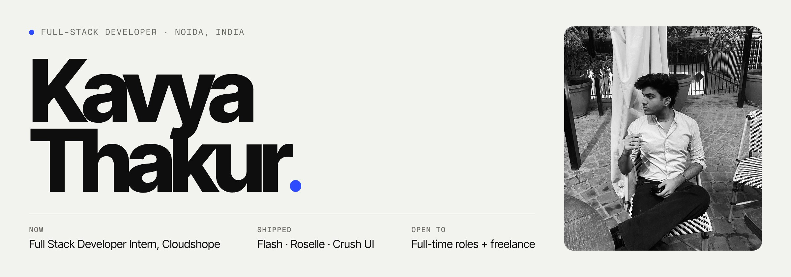
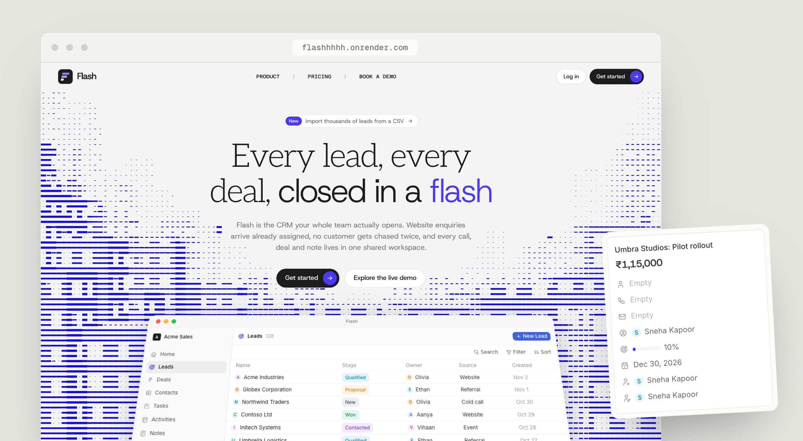
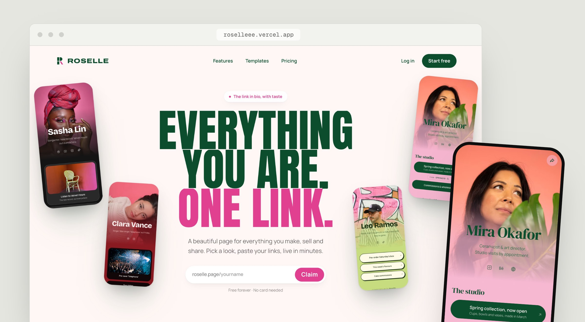
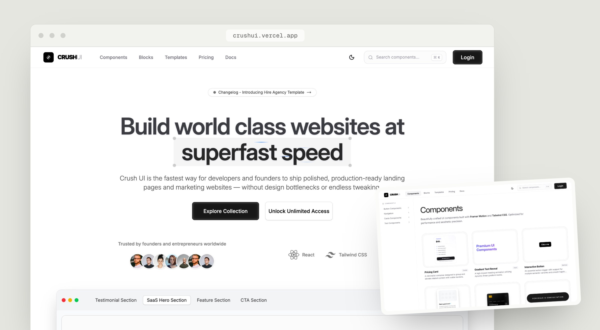
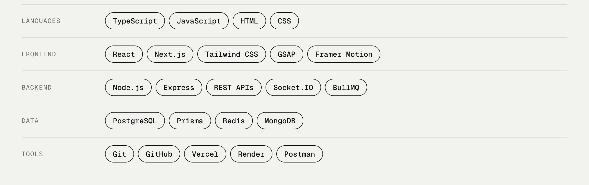

 

Full-stack developer who builds and ships complete web products with **Next.js, TypeScript and PostgreSQL**, from database design and APIs to the interface people actually use.

Below are three I designed, built and launched on my own: a real-time sales CRM, a link-in-bio platform for creators, and a React component library. Each one is live, so you can try it before reading the code.

**Open to full-time roles and freelance projects.**

  
  
  
  

 

## Selected work

### 01 · Flash
**A real-time, multi-tenant sales CRM.** Every company gets its own workspace with roles and permissions. Leads from web forms, Google Ads, IndiaMART, Zapier and CSV land in one pipeline, get assigned by automation rules, and move through kanban deals to a live manager dashboard. Every open tab updates within a second.

`Next.js 16` `TypeScript` `PostgreSQL` `Prisma` `Redis` `BullMQ` `Socket.IO` `Razorpay`

**[Live demo ↗︎](https://flashhhhh.onrender.com)** &nbsp;·&nbsp; [Code](https://github.com/kavya-thakur/crm) &nbsp;·&nbsp; [Case study](https://kavyaportfoliooo.vercel.app/work/flash)

 

### 02 · Roselle
**A link-in-bio that turns visitors into clients.** Creators pick from 25 templates, build their page in a live-preview editor, and get everything after the tap: enquiries, bookings, payment-link requests, verified reviews, and privacy-first analytics that show which sources bring paid work.

`Next.js 16` `TypeScript` `PostgreSQL (Neon)` `Prisma` `Zod`

**[Live site ↗︎](https://roselleee.vercel.app)** &nbsp;·&nbsp; [Code](https://github.com/kavya-thakur/roselle) &nbsp;·&nbsp; [Case study](https://kavyaportfoliooo.vercel.app/work/roselle)

 

### 03 · Crush UI
**A React component library.** 30+ typed components, templates and blocks, with subscription-gated premium components.

`React` `TypeScript` `Node.js` `MongoDB`

**[Live site ↗︎](https://crushui.vercel.app)** &nbsp;·&nbsp; [Code](https://github.com/kavya-thakur/crushui)

 

## Stack

 

kavya.fosnix@gmail.com · Noida, India · <a href="https://kavyaportfoliooo.vercel.app">kavyaportfoliooo.vercel.app</a>

